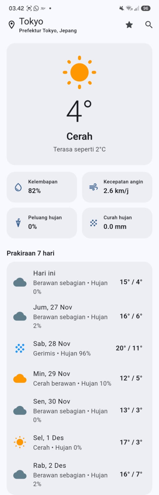
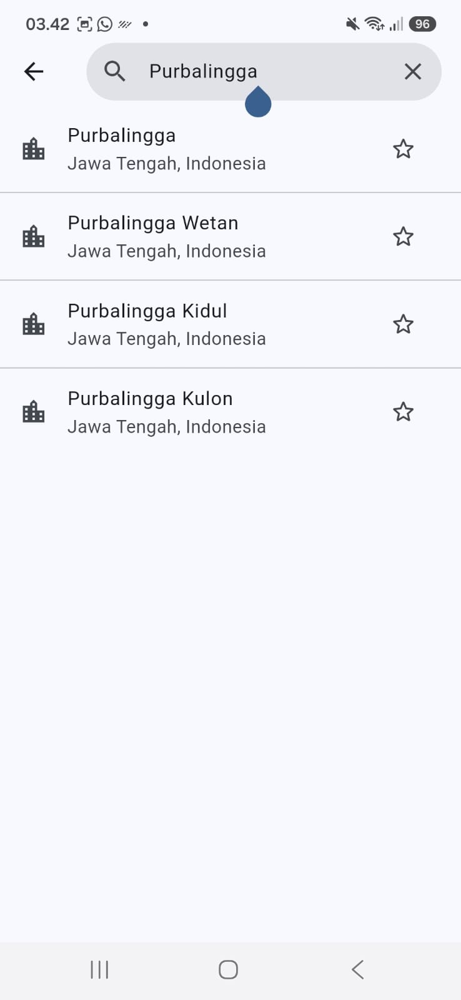

# Weather App (Flutter + Open-Meteo)

Arsitektur: MVVM | State: Provider | Storage: SharedPreferences | API: Open-Meteo

## Dokumentasi Aplikasi
### Home Screen

### Search Screen

## Cara menjalankan
1. `flutter create weather_app`
2. Ganti folder `lib/` dan file `pubspec.yaml` dengan milik project ini
3. Hapus `test/widget_test.dart` (bawaan template, akan error)
4. `flutter pub get`
5. `flutter run`

## Android release: tambahkan izin internet
Di `android/app/src/main/AndroidManifest.xml` (di atas tag <application>):
`<uses-permission android:name="android.permission.INTERNET"/>`
